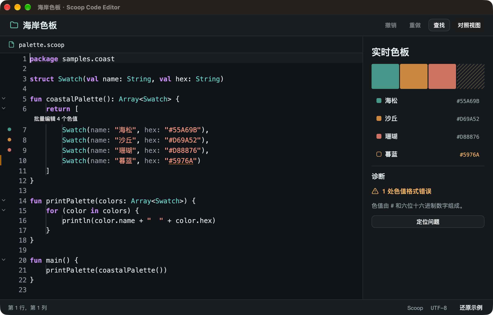

# Scoop Code Editor

`scoop:scoop.ui.editor` 是一个独立的 Scoop 库 Cone。`CodeDocument` 保存 UTF-8 正文和共享撤销历史，`CodeEditorState` 保存一个视图的选区与阅读位置，`codeEditor(state)` 返回可嵌入布局的 `View`。正文由自己的 `Element` 排版、绘制、命中并接收原生输入。

## 运行原生演示

安装带 GUI 组件的 Scoop 工具链后，在仓库根目录运行下面的命令。Windows 使用 `sco run examples/playground --release`。

```sh
scoop run examples/playground --release
```

“海岸色板”左侧是可编辑的 Scoop 源码，右侧从当前文档中的 `Swatch("名称", "#RRGGBB")` 行生成色板。点击色板中的任意一行，会选中源码里对应的色值。



- 点 **定位问题**，把暮蓝的 `#5976A` 替换为 `#5976A8`。斜纹色块会变蓝，编辑器里的波浪线和右侧警告一起消失。
- 点源码第一个色值上方的 **批量编辑 4 个色值**，然后输入一个新色值。四个选区会一起改动，点一次 **撤销** 即可还原。
- 点 **对照视图**，修改左侧源码，两栏会同步更新。右侧只读，默认折叠了 `printPalette`，两边可以独立折叠和滚动。
- 点 **查找** 试用正则查找和替换，或用 **还原示例** 重新开始。示例在内存中编辑，还原操作也可以撤销。

完整示例见 [examples/playground](examples/playground)。

## 嵌入编辑器

相邻目录的宿主 Cone 可这样声明依赖。

```toml
[dependencies]
"scoop:scoop.ui" = "0.1.0"
"scoop:scoop.ui.component" = "0.1.0"
"scoop:scoop.ui.editor" = { version = "0.1.0", path = "../scoop-code-editor" }
```

两个视图可以从同一份文档开始，共享语法 token，各自选择配色并拥有焦点、选区、折叠、滚动和扩展。配对括号可跳转或扩选，选区同文与当前视觉行独立高亮。宿主可按来源发布诊断，用户可悬停查看并用 F8／Shift+F8 导航。下面的左侧视图支持用主修饰键加 F 打开查找面板。滚动条、查找和转到行列面板沿用宿主的 `ThemeSource`。独立挂载时使用内置浅色主题。使用 Scoop UI 控件的应用在 `context(themeSource) { Application().run(host) }` 中挂载。

```kotlin
import scoop.ui.*
import scoop.ui.component.*
import scoop.ui.editor.*

class SplitEditor(scope: ComponentScope) : Component(scope) {
    private val document = CodeDocument("val count = 1\n", Some(scoopCodeLanguage()))
    private val left = scope.resource { CodeEditorState(document) }
    private val right = scope.resource { CodeEditorState(document) }
    private val find = scope.resource { CodeFind(left) }

    public override fun render(): View {
        val first = codeEditor(left)
        val second = codeEditor(right)
        return row {
            item(first) { grow = 1.0 }
            item(second) { grow = 1.0 }
        }
    }
}
```

文档可以脱离窗口使用。`document.applyEdits` 接受同一版本的一批 UTF-8 字节范围替换。视图操作通过 `executeEdits` 加入同一份撤销历史。宿主也可以登记动作、设置范围装饰，或安装跟随文档位置的控件、行前／行后批注、按需解析的 CodeLens 按钮，以及参与折行和点击的行内提示。详见[公开接口约定](docs/SPEC.md)和[设计](docs/DESIGN.md)。

## 本地验证

宿主需要安装 Scoop 工具链和当前平台的 GUI 组件。上面的双视图示例使用 Scoop 主仓提交 `8d42bfb47` 验证。该版本包含自绘视口的主题滚动条、多行文本无障碍语义及独立宿主消费编辑器库所需的泛型修复。[原生无障碍接口](https://github.com/scoop-lang/scoop/pull/219) · [视口滚动条](https://github.com/scoop-lang/scoop/pull/222) · [跨 Cone 泛型修复](https://github.com/scoop-lang/scoop/pull/225)

`validation/appkit.sh` 在当前 macOS 桌面会话中以前台应用运行测试，覆盖真实原生输入、拖选、窗口焦点和辅助技术。可按用例或测试容器名称筛选。性能测量比较十万短行和同字节数的单条长行，分别在普通及开启扩展时各启动三个新进程。[本机测量结果](docs/PERFORMANCE.md)

```sh
scoop check . --tests --release
./validation/appkit.sh
./validation/appkit.sh test NativePointerTests ViewportCommandTests
./validation/appkit.sh benchmark
```

Linux 和 Windows 的原生协议用例需要一个独立客户端。先运行常规测试，再从仓库根目录启动相应客户端。[桌面协议验证入口](validation/desktop.py)

| 平台 | 运行方法 | 覆盖 |
| --- | --- | --- |
| Linux | `scoop test . --release` 和 `python3 validation/desktop.py`。协议用例在独立的 D-Bus 与 Xvfb 会话中运行，需要 GTK 4、系统 Python 的 PyGObject 与 AT-SPI 2、Openbox 及 xdotool。常规窗口用例需要可用显示 | GTK 组合输入、提交中文、AT-SPI 全文读取、非 ASCII 选区与辅助编辑 |
| Windows x64 | 在已登录的桌面运行 `sco test . --release`。在带 MSVC 和 Windows SDK 的 x64 开发者终端运行 `python validation/desktop.py` | TSF 查询当前行和候选窗坐标、组合输入与提交，独立 UI Automation 客户端读取全文、设置选区与改写正文 |

三平台均用包含 CRLF、中文和 emoji 的正文验证原生输入。常规测试中标为忽略的桌面协议用例由上面的专用入口执行。
